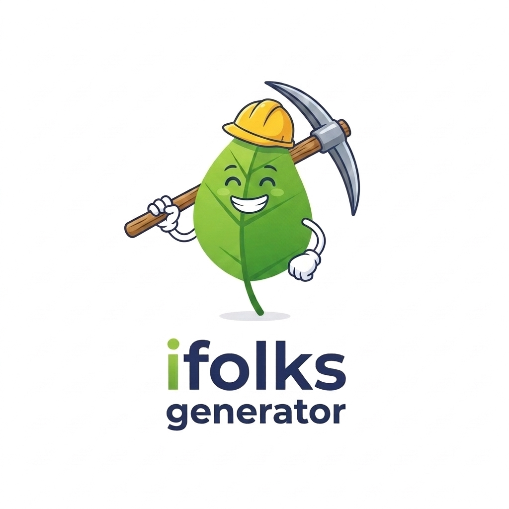

<p align="center">
  
</p>

<h1 align="center">iFolks Generator</h1>

<p align="center">
  <a href="https://generator.ifolks.org"></a>
  
  
  
  
</p>

<p align="center">
  <strong>The Model-Driven Scaffolding &amp; Code Generation Platform for the iFolks Ecosystem</strong>
</p>

---

## 📖 Official Documentation

To avoid documentation drift, complete architectural guides, reference manuals, and tutorials are maintained on our official portal:

👉 **[https://generator.ifolks.org](https://generator.ifolks.org)**

* 📖 **[User Guide](https://generator.ifolks.org)**: CLI installation, `skeleton.xml` full specification, business key cardinalities, relationships, and multi-step data populator.
* 🛠 **[Developer Guide](https://generator.ifolks.org)**: Internal 9-module architecture, 4-phase generation pipeline, `DatabaseHandler` SPI, validation checkers, and extension recipes.
* 📦 **[Releases & Changelogs](https://generator.ifolks.org)**: Detailed version history and upgrade paths.

---

## ⚡ Quickstart

```bash
# 1. Initialize a new project metadata workspace
igen init

# 2. Edit your data-model/skeleton.xml to declare your entities and relations

# 3. Generate your decoupled Spring Boot 4 + Angular application
igen generate

# 4. Compile and run integration tests
cd [project]-tests && mvn clean install
```

---

## 📦 Distribution & Artifacts

* **CLI Binary**: [`generator-bash-1.2.0-bin.zip`](https://repo1.maven.org/maven2/org/ifolks/generator/generator-bash/1.2.0/generator-bash-1.2.0-bin.zip) on Maven Central.
* **Metadata Schema**: `skeleton-metadata-1.0.xsd` under `generator-model`.

---

## 📝 License

Distributed under the **Apache Software License, Version 2.0**. See [`LICENCE.md`](LICENCE.md) for details.
